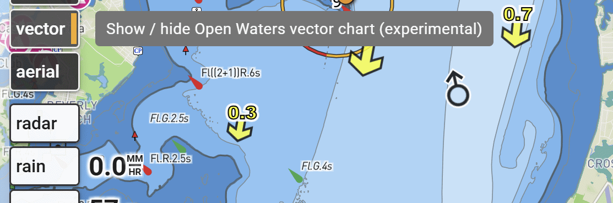

### UI Update

DeepZoom got a UI makeover in this release.  With the help of Anthropic's Claude Opus 5.5 (max), virtually every UI element has been rethought and retooled, unifying the prior somewhat haphazard accumulation of features.

- The left hand column of layers buttons now can be scrolled offscreen.
- Routes display their length dynamically when editing instead of only when the edit completes.
- Auto routes highlights the nearest node when hovering.
- Many dialogs such as Help and AI Chat can be expanded vertically.

### Vector Charts

<a
    href="https://openwaters.io"
    target="_blank"
    >Open Waters</a> 
has begun publication of open source vector charts and this layer has been incorporated into DeepZoom.  It should be considered experimental, spatial resolution varies throughout the world, and the tide level datum is not uniform but rather varies with the source of the chart data.

This layer is undergoing rapid development.

{: .border .align-center .toc}

In terms of layering, vector charts underlay the existing raster charts.
Both layers can be displayed simultaneously by adjusting the layer opacity.

### Tracking

Tracks and tracking got a major upgrade in this release.

- Tracks are now completely unified into the timebase engine within DeepZoom and are peers of routes.  Tracks maintain UTC timestamps for each point along the track, so dragging the timeslider gives an accurate rendition of position vs time.  
- You can set up a route, then turn on tracking and compare the plan vs reality. Both can be animated simultaneously.  The track can optionally show the elapsed distance and % complete.
- Just like routes, any number of tracks can be added to a trip.
- Tracks can overlap other tracks or routes in time.
- Tracks now create one or more gaps whenever the GPS signal is lost.  These gaps do not contribute to the track length or to the trip length.
- Tracks can be auto named from UTC starting time, local time, sequence number, or the names of the start and end locations.
- On phones, prevent auto screen lock when tracking.

### World wide tide stations

Tide station coverage is now worldwide using data from   
<a
    href="https://openwaters.io"
    target="_blank"
    > Open Waters</a>.
These stations are mostly derived from TICON-4.
Tide stations in USA and Canada still use NOAA and CHS sources.

### Search everywhere

When clicking on a public marker, information added to DeepZoom is displayed along with a new "Search the web" button.  

- Search algorithm has been improved, giving more precise location targeted results.
- .gov and .org are shown first
- No ads!

### Other

- Claude discovered a major perf improvement.  While DeepZoom was always reasonably quick, now it refuses to get bogged down no matter what you throw at it!

### How Should Oliver get home?

[Oliver Widger](https://www.facebook.com/sailing.with.phoenix/){:target="_blank"}  is sailing non stop around the world in a Pacific Seacraft 40, the same model a my boat ([which is for sale]()).  While  near term navigation decisions are dictated by weather, the long term plan is likely a function of  long term wind patterns and ocean currents.

The Pilot Charts layer in DeepZoom is an ideal tool for modeling this.  Here's my best guess as to an optimal non-stop route home to Port Townsend.  You can try out your best guess by just grabbing the waypoints and dragging them around, even without stopping the animation!

<iframe id="theIframeOliver"
    title="DeepZoom: Oliver Widger's route"
    style="height: 90vh"
    allow="clipboard-read; clipboard-write"
    src="{{ site.deepzoom_host }}/trip/c3v63et7">
</iframe>

