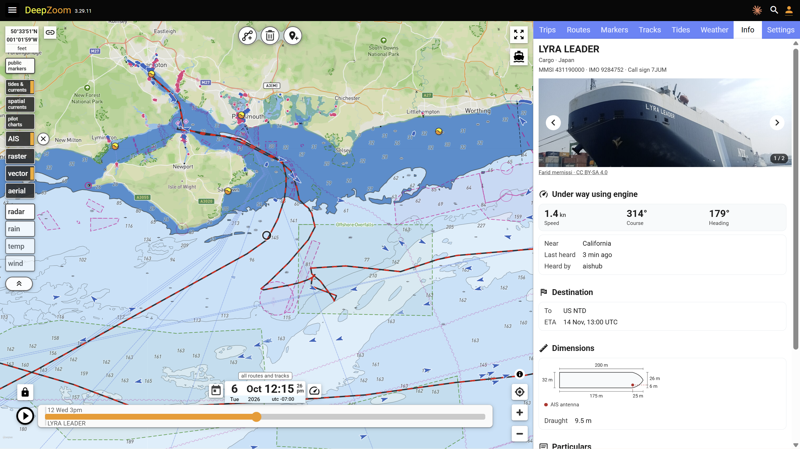
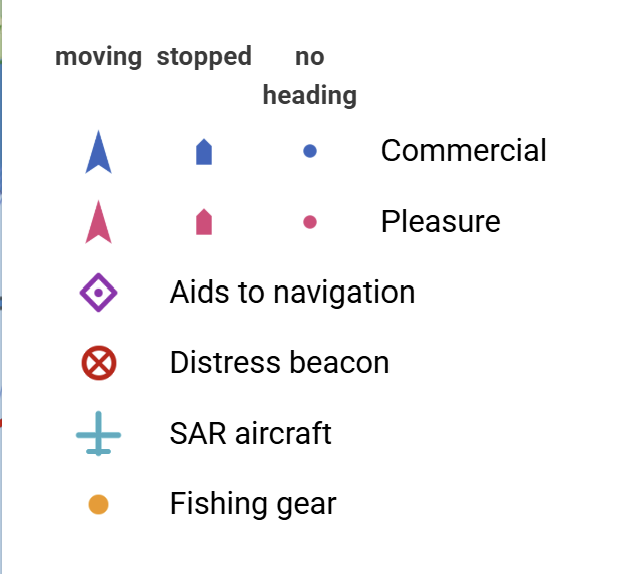
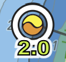

## AIS

The AIS layer shows the tracks of commercial and pleasure vessels equipped with Automatic Identification System (AIS) transmitters.  <a
    href="https://openwaters.io"
    target="_blank"
    >Open Waters</a> is graciously hosting this data for free.  At present, only terrestrial AIS receivers are used to source the data, as the feed from satellite-based AIS receivers is quite expensive.  Nevertheless, near-shore coverage is pretty good. 

{: .border .align-center .toc}

AIS tracks fully participate in the DeepZoom timebase, so you can scroll time to visualize the vessel's location up to a year in the past.

Selecting another vessel replaces the prior track.  Only one AIS track is displayed at a time.  To see multiple AIS tracks, save the AIS track in a trip.  Saving to a trip converts an AIS track into a normal track, allowing you to visualize multiple vessels.

Pleasure and commercial vessels are distinguished by color; moving and stopped vessels use different symbols.  When you click on a vessel, its track is displayed.  The duration of the track you wish to display (1 hr, 1 day, ... 365 days) is selected on the AIS toggle button flyout.  To hide the displayed AIS track, click the "X" next to the AIS button.

## Live tides

One of the most visible ocean signals this year is the Kelvin wave moving northward and southward along the eastern edge of the Pacific Ocean due to the 2026 El Niño event.

Partly to visualize this phenomenon, but also to give visible confirmation of the accuracy of DeepZoom tide and current predictions, I've hooked up historical and live tide and current measurements from NOAA and CHS for selected stations.  

Stations with live tide and current measurements have a white halo as shown here for La Jolla (Scripps Pier). The new observed line is shown in blue.

<iframe id="theIframeLiveTides"
    loading="lazy"
    title="LiveTides"
    allow="clipboard-read; clipboard-write"
    src="{{ site.deepzoom_host }}/trip/rx7wasn7">
</iframe>

### Other

- Tide and current event times were off by 1 hour after 1 Nov 2026 due to DST changes in BC.  The graph was correct, just not the event labels.  Fixed now.
- You can now drag the slider in the TideGraph.  The tide table of daily events is now arranged chronologically.
- Timewarp now collapses time between segments of a track.
- Tracks have a new color pattern to distinguish them from routes.
- `mapAIS` and `UI` scripting events added.
