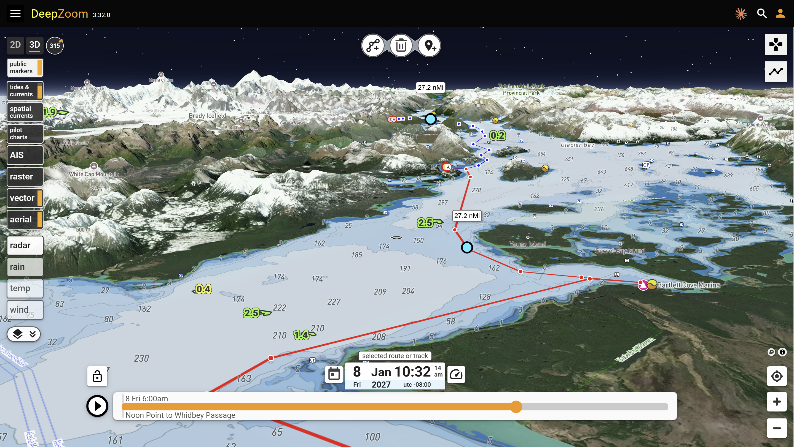
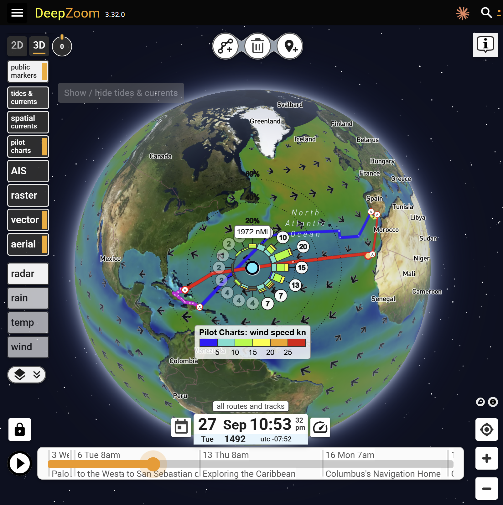
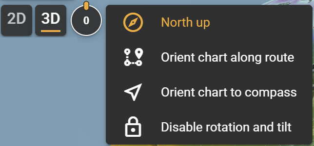
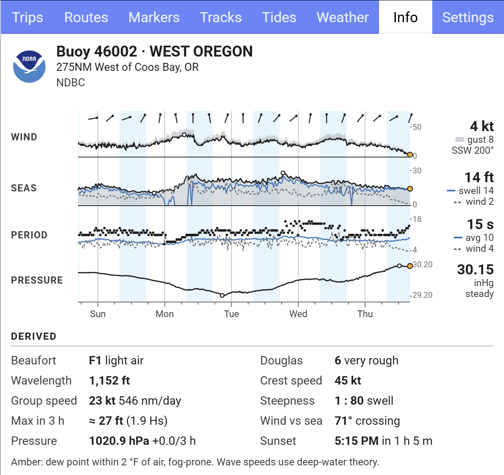

## 3D

After a hiatus of many years, 3D has made a comeback.  3D is mostly useful for ocean spanning trips, world weather patterns, and showing vertical terrain.  And it's great eye candy!

{: .border .align-center .toc}

**All** DeepZoom features work in 3D.  Editing routes (up to 85° north and south), weather (including over the poles), tides and currents, pilot charts and 2D currents.   

But 3D and terrain also consume more resources in both bandwidth, CPU, and GPU.  If your trip is seeming a bit slugish, try swithing back to 2D.

{: .border .align-center .toc}

## Map orientation and compass

Use the 2D and 3D buttons to choose between mercator projection and a globe display.  Then in the flyout, choose how (or if) you want the map to rotate.

{: .border .align-center .toc}

- **North up** Set rotation and tilt to zero, but allow modification.
- **Orient chart along the route** rotate the map automatically to follow the selected route.
- **Orient chart to compass** rotate the map automatically to always point the top of the chart to true North. This option is only available on devices with a built in compass.
- **Disable rotation and tilt** set rotation and tilt to zero and prevent changes.

While tracking, select **Orient chart to compass** to keep the chart aligned with your heading.

## Buoy enhancements

Buoys have a new icon.

Buoys with wind sensors are now shown with the latest wind speed in knots and an arrow pointing in the direction the wind is blowing.

Buoys without wind sensors (or with non-functioning sensors) are shown with a wave icon.

Clicking on either one shows a new graph with the last 5 days of measurements for that buoy (2 days on phones).

{: .border .align-center .toc}

Depending on the sensors available, measurements include wind and gusts, seas, swell and wind waves, wave periods, pressure, air and sea temperature.

Derived values: Beaufort force, sea state, wavelength, crest speed, max wave in 3 hours, and others.
The graphs follow the time slider when it's within those 5 days. Drag across the graphs to read any moment.

Units in the graph follow your settings (12/24 h, °F/°C, ft/m, kt/mph/km/h).

## Tides and currents

- Change time by dragging the vertical time bar in the tide graph display.
- You can now selectively disable either tides or currents in the flyout beneath the opacity slider.

## Weather

New rain colors, in weather-radar greens, yellows and reds. No blue, so rain can't be mistaken for water.

## Scripting

For too long I kept adding a new API/Event for each new layer added to DeepZoom (mapOpacityRadar, mapOpacityPilotCharts, etc).  I finally realized it's much cleaner and easier for script writers to just have a single API/Event **mapLayers** which records the state of all layers.

This change is backward compatible with all existing scripts, but any new scripts saved will use this single layer API/Event.

Other scripting changes:

- `map2D3D`: switch 2D / 3D and set orientation (`north`, `route`, `compass`, `locked`).
- `mapFlyTo` and `mapJumpTo` take `pitch` and `bearing`.
- `selectMarker` renamed to `markerSelect`. Old scripts still work.

Scripting documentation: [https://www.deepzoom.com/doc/index.html](https://www.deepzoom.com/doc/index.html){:target="_blank"}
{: .notice--warning}

### Other

- Restyled route lines, with A and Z endpoints.
- Restyled toasts and clearer network error messages.
- Fixed trips and searches whose bounding box spans the 180° meridian.

Try out 3D by sailing into the Loften Islands to get some yummy fresh Lutefisk: [https://www.deepzoom.com/trip/q2gartba](https://www.deepzoom.com/trip/q2gartba){:target="_blank"}
{: .notice--warning}